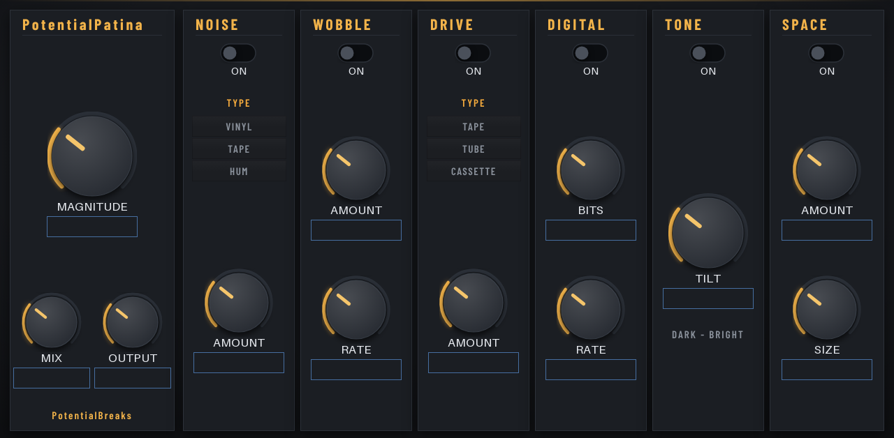

# PotentialPatina

**Instant character.** A retro-colour box for any track: vinyl crackle, tape hiss and wobble, warm drive, bit-crushing, tone and a small room, all set with one big **MAGNITUDE** knob.

*Insert effect · MPC OS 3.x · Gen1 and Gen2 · v1.1.2*

Inspired by the "retro colour" style of plugin made popular on computers. Not affiliated with any of them.

Free and open source (MIT), made by **PotentialBreaks**. It runs inside the MPC like its own effects, with its own touchscreen page, Q-Link control and project recall, and no computer needed while you play.

**[Download the latest release](../../releases/latest)** · [Install guide](INSTALL-GUIDE.md) · [FAQ](FAQ.md) · [Ideas and bugs](../../issues/new/choose)

## What it does

| Section | What it adds |
|---|---|
| **MAGNITUDE / MIX / OUTPUT** | Fade the whole effect in and out, blend it with the dry sound, set the level |
| **NOISE** | Vinyl crackle, tape hiss or mains hum |
| **WOBBLE** | Tape wow and flutter (pitch drift) |
| **DRIVE** | Tape, tube or cassette saturation, level-matched so it doesn't just get louder |
| **DIGITAL** | Bit depth and sample-rate reduction, for the old-sampler crunch |
| **TONE** | One dark–bright tilt knob |
| **SPACE** | A small room |
| **ROLL** | One tap switches on a random set of sections with random settings. **MILD**, **MEDIUM** or **WILD** under it sets how far it goes |

Each section has its own **ON** switch.

**Presets:** Patina, Dusty Vinyl, Worn Tape, Cassette Demo, 12-bit Sampler, Crunchy 8-bit, Old Radio, Basement Room and Clean. They're set fairly subtle, so turn MAGNITUDE or the section knobs up for more.

## How to use it

Add it as an **insert effect** on a track, program, pad or bus. It won't be in the instrument list. Start with a preset, then use MAGNITUDE to set how much.

## Three looks

PotentialPatina comes in three looks: **Print Plate** (the default), **Night Rack** and **Colour Block**. Open the **SETTINGS** page and tap one of the big LOOK keys. The new look shows the next time the plugin loads: take it off the track and add it again, or load your project again. Your choice is kept on your MPC for every project. The sound and the controls are the same in all three.

## Limitations

- **About 7 ms of delay** while it's switched on, because of how the wobble works. It's rarely noticeable, but it can be on tight layered drums.
- **Stereo in, stereo out**, at 44.1 kHz.
- **CPU use on the MPC hasn't been measured yet.** Several copies at once, especially with SPACE on, may be a lot for a Gen1 MPC.
- **Tested on an MPC One only** (Gen1). The 64-bit build for Gen2 MPCs passes Akai's own checks but hasn't been tried on a Gen2 MPC yet.

## Will it work on my MPC?

| | |
|---|---|
| **Tested on** | MPC One (Gen1): with Akai's plugin folder on **MPC OS 3.10.1**, and with the community set-up on HAKAI 3.10 |
| **Should work on** | Any standalone MPC on **MPC OS 3.10.1 or later**: 32-bit (One, One+, Live, Live II, X, Key 61, Key 37) and 64-bit (Live III, XL, One Gen 2, Key 37 Gen 2). Also Gen1 MPCs on older MPC OS 3.x with the community set-up |
| **Not supported** | **MPC OS 2.x** |

The **Should work on** row is untested so far. If you try it on another model, please [tell me how it went](../../issues/new/choose).

## Install

**👉 [Step-by-step install guide](INSTALL-GUIDE.md)**

**On MPC OS 3.10.1 or later** (any standalone MPC, no hacking):
1. Download `PotentialPatina-<version>-akai-vst2.zip` from [**Releases**](../../releases) and unzip it on your computer.
2. On the MPC, turn on **Preferences → Enhancements (Beta) → Enable Enhancements** and **External Plugin Support**.
3. Copy the folder **PotentialBreaks - VST - PotentialPatina** into a folder called **VST2 Plugins** at the top of a USB stick, SD card or the internal drive, and restart.
4. It's in **External Plugins**, as an effect.

**On older MPC OS 3.x (Gen1, community set-up):** download `PotentialPatina-<version>-mpc-armv7.zip` instead and install it with the free **MPC Plugin Installer** from [Open MPC](https://open-mpc.github.io/), or over SSH (see the guide). Save your project first, because installing restarts the MPC app.

Install it one way only, or it shows up twice. Stuck? The [**FAQ**](FAQ.md) covers the common problems.

## Also good to know

- **Made by one person, tested on one MPC.** It works well for me, but you may hit something I haven't. Please tell me if you do.
- **Plugins must be allowed to run on your MPC.** On MPC OS 3.10.1 or later, that's the **External Plugin Support** switch in Preferences → Enhancements (Beta). On older firmware, your MPC needs the community set-up from [Open MPC](https://open-mpc.github.io/), which you may have to redo after a firmware update.
- **No warranty.** It's free and comes as it is. Back up your projects.

## Ideas, bugs and criticism: all welcome

I make these for myself first, and I want them to be good for everyone else too, so **please tell me what you think**, including what you don't like.

- 💡 [Suggest a feature](../../issues/new?template=idea.yml)
- 🐛 [Report a bug](../../issues/new?template=bug.yml)

You don't need to be technical. Short messages are great. See [CONTRIBUTING.md](CONTRIBUTING.md) for more, including how to send code.

## More from PotentialBreaks

- **[PotentialBreaks](https://github.com/PotentialBreakfast/mpc-vst-potentialbreaks)**: Drum-break slicer: a random break from your library on 16 pads, chopped and tempo-matched.
- **[PotentialWax](https://github.com/PotentialBreakfast/mpc-vst-potentialwax)**: Melodic sampler: pick or dig a song from your library, 16 cues found for you, matched to your tempo and key.
- **[PotentialNoise](https://github.com/PotentialBreakfast/mpc-vst-potentialnoise)**: Calibrated pink noise reference for mixing: one-tap RMS levels, mono/stereo, full or limited range, live meter.
- **[PotentialPunch](https://github.com/PotentialBreakfast/mpc-vst-potentialpunch)**: Transient shaper: more or less punch and tail on drums and anything else, with one-tap presets.
- **[PotentialHeat](https://github.com/PotentialBreakfast/mpc-vst-potentialheat)**: Soft clipper and bus saturator: warmth, glue and loudness without clipping, with one-tap presets.
- **[PotentialWarp](https://github.com/PotentialBreakfast/mpc-vst-potentialwarp)**: Tempo-locked mangler: stutters, half speed, tape stops, spinbacks, reverses and gates in 16 one-tap patterns.
- **[MPC TOOLS](https://github.com/PotentialBreakfast/mpc-tools)**: a free second-screen app for Windows: your MPC's screen live on your PC (and in OBS), file transfer, your PC's folders on the MPC, and one-click "save the last 60 seconds".

## Build it yourself

See [BUILD.md](BUILD.md).

## Credits

- Built on **[mpc-vst-plugins](https://github.com/sd88me/mpc-vst-plugins)** by sd88me (MIT), the open kit that makes MPC plugins possible: the plugin wrapper, skin builder and installer.
- Fonts: **Jost**, **DM Mono**, **IBM Plex Sans Condensed**, **IBM Plex Mono**, **Bricolage Grotesque** and **Space Mono** (SIL Open Font License 1.1), in `vst/skin/looks/fonts/` with their licences.
- The dark look grew out of the theme I made for sd88me's Lucky Dip.
- Made with help from Claude (Anthropic).

Not affiliated with or endorsed by Akai Professional or inMusic. MPC is their trademark.

## Licence

[MIT](LICENSE): free to use, change and share, including in your own projects. Third-party parts keep their own licences ([THIRD_PARTY.md](THIRD_PARTY.md)).
